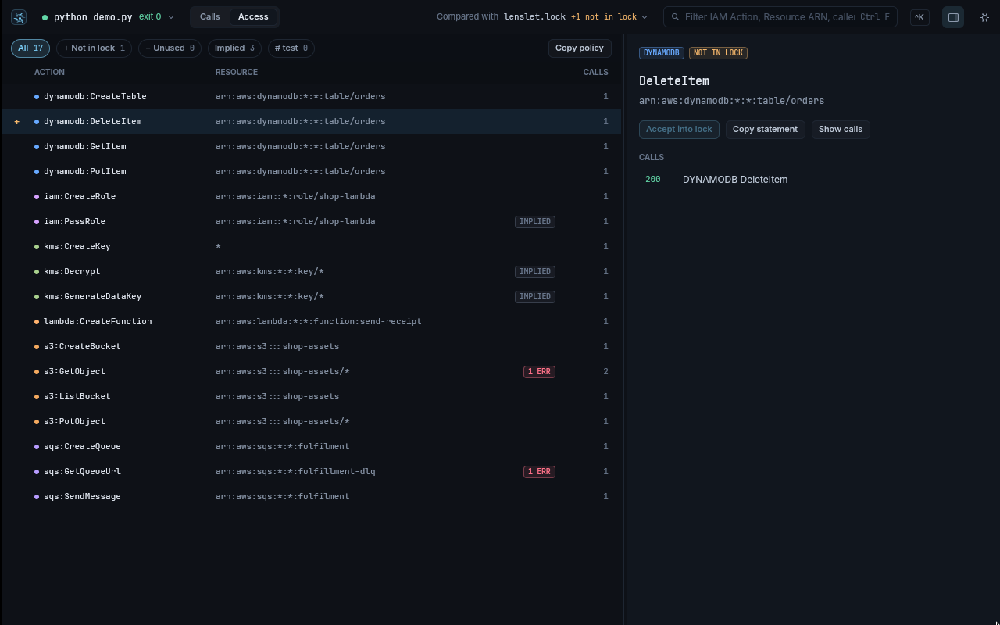

# Lenslet

**See, in every pull request, what AWS access your code needs, and why its
AWS calls failed.**

Lenslet runs your tests against a local AWS emulator. It records every AWS
call, explains failures, and works out the IAM permissions the code uses. It
keeps those permissions in `lenslet.lock`, a file you commit. When a pull
request widens AWS access, the PR says so, call by call, and CI fails until
someone accepts the change.

AWS Emulator does not evaluate IAM, so code that works locally can still be
denied on AWS. Lenslet covers that gap in code review. With `--enforce` it
also blocks unauthorized calls live at the proxy with real AWS `AccessDenied`
responses, and `lenslet check --policy role.json` tells you, without
re-running anything, whether a recorded run would pass under a real IAM
policy and which statement would deny it.

> **Lenslet · `npm test` passed**
>
> 15 AWS calls · 0 errors · 4 services
>
> **1 permission not in `lenslet.lock`.** Review it; if it is intended, run `lenslet run --update` and commit `lenslet.lock`.
>
> | | Permission | Resource | Needed by |
> |---|---|---|---|
> | + | `dynamodb:DeleteItem` | `arn:aws:dynamodb:*:*:table/orders` | DYNAMODB DeleteItem |

## Start

```bash
curl -fsSL https://github.com/hxddh/lenslet/releases/latest/download/install.sh | sh

# with your emulator running (e.g. AWS Emulator on 9298):
lenslet init -- npm test
```

`lenslet init` checks that the emulator answers, runs your tests once to
write `lenslet.lock`, and adds `.github/workflows/lenslet.yml`. Review the
lock, mark lines that only your test fixtures need with `# test`, then commit
both files. From then on every pull request gets the report.

On a Mac, [Lenslet.dmg](https://github.com/hxddh/lenslet/releases/latest) also
gives you the window. The app is not notarized yet, so the first time you open
it go to System Settings → Privacy & Security → Open Anyway.

## In CI

The workflow `lenslet init` writes uses the Lenslet action:

```yaml
permissions:
  contents: read
  pull-requests: write          # one PR comment, updated in place
steps:
  - uses: actions/checkout@v5
  # install your test dependencies
  - uses: hxddh/lenslet@lenslet-v9.0.0
    with:
      command: npm test
      emulator: moto_server -p 9298           # or however you start your emulator
      upstream: http://127.0.0.1:9298
```

The action does five things:

- It installs the pinned Lenslet and checks its checksum.
- It starts the emulator if you give it one, and waits until it answers.
- It runs your command with `--check`.
- It writes the report to the job summary.
- It keeps one PR comment up to date.

Until a `lenslet.lock` exists, it only reports.

| input | default | |
| --- | --- | --- |
| `command` | — | the test command (bash, in `working-directory`) |
| `upstream` | `9298` | the emulator: a port (HTTPS on 127.0.0.1) or a URL |
| `emulator` | | a command that starts the emulator in the background |
| `working-directory` | `.` | where to run and find the lock |
| `lock` | `lenslet.lock` | lock path, relative to `working-directory` |
| `policy` | | IAM policy JSON path to check/enforce instead of `lenslet.lock` (supports `Allow`, `Deny`, `NotAction`, `NotResource`, and wire-level IAM `Condition` blocks) |
| `check` | `true` | fail when access grows (exit 3) |
| `strict` | `false` | also fail when the lock lists access the run did not use |
| `enforce` | `false` | actively deny calls outside the lock/policy with AWS `AccessDenied` |
| `comment` | `true` | post or update the PR comment (fork PRs get the job summary only) |
| `version` / `binary` | from the pinned tag | another release, or a binary you built |

Outputs: `exit-code`, and `report`, the path to the JSON report.

For AWS Emulator in CI, install it the way its docs describe (on Linux, a
`.deb` or `.rpm`), then set `emulator: aws-emulator --telemetry off --port 9298`.
[moto](https://github.com/getmoto/moto) (`pip install 'moto[server]'`) and
LocalStack also work as upstreams. Lenslet's own CI runs the action this way
against [examples/python](examples/python).

## What a run shows

```console
$ lenslet run --check -- npm test
...your tests...
lenslet: 24 calls · 2 errors · 4 services (dynamodb, lambda, s3, sqs) · 476 ms
  ✗ DYNAMODB GetItem  400  ResourceNotFoundException  Requested resource not found
      → Region mismatch: `table/orders` was created in `us-west-2` at call #2 (CreateTable), but this `GetItem` targeted `us-east-1`.
  ! DYNAMODB GetItem ×8 in a serial burst
      → 8 calls on table/orders, one after another in 31 ms: `BatchGetItem` does this in fewer round trips.
  · 2 resources created and not deleted: s3://shop-receipts, SQS fulfilment
  access: 1 permission not in lenslet.lock
    + dynamodb:DeleteItem              arn:aws:dynamodb:*:*:table/orders
  unused: 1 permission in lenslet.lock not exercised by this run
    - dynamodb:GetItem                 arn:aws:dynamodb:*:*:table/orders
```

- **Findings first**: one ranked list of what is worth a look. Failures come
  with their cause, including cross-call correlation (a region mismatch against
  an earlier `CreateTable`/`CreateQueue`, a resource deleted earlier in the
  run, common local setup gaps). Serial bursts that a batch API would collapse
  (N+1), SDK retries, and resources the run left behind are also listed.
  The same list leads the terminal, the PR comment, the JSON report and the
  window.
- **What it needs**: each call becomes a verified AWS IAM action on a resource
  ARN, with account and region as `*`. The mapping covers:
  - batches: one entry per table or SSM parameter;
  - transactions: each item's own action;
  - copies & subresources: source reads, `PostObject` → `s3:PutObject`, and
    exact S3 subresource IAM action names (`s3:GetBucketPublicAccessBlock`,
    `s3:GetBucketNotification`, `s3:GetReplicationConfiguration`, …);
  - implied permissions, where the key or role is on the wire: KMS for S3
    SSE-KMS (request or response headers), Secrets Manager and SSM writes that
    name a key, SQS/SNS queues and topics created with a key, DynamoDB
    `SSESpecification` and Kinesis stream encryption; `iam:PassRole` for
    Lambda, Step Functions, ECS (`taskRoleArn` and `executionRoleArn`),
    EventBridge (rules and `Targets[].RoleArn`), Scheduler, Pipes, Firehose
    and Glue. The key of an existing encrypted queue, topic or secret is not
    in the request that uses it, so it is not derived.
  - a request whose body is not readable (binary such as CBOR, or over the
    inspection limit) gets its action on `*`, marked unverified, rather than a
    guessed resource.

  Generated names (UUIDs, timestamps) become `*`, so the lock stays stable.
- **What changed**: compared with `lenslet.lock` (added, unused) and with the
  previous run of the same command (new failures, fixed).

This is **observed** access: what your tests exercised, mapped by rules. It
is not a security review. Code paths the tests never reach are not in the lock.

### The lock

```text
# lenslet.lock
dynamodb:CreateTable  arn:aws:dynamodb:*:*:table/orders  # test
dynamodb:PutItem      arn:aws:dynamodb:*:*:table/orders
kms:Decrypt           arn:aws:kms:*:*:key/*  # implied
s3:GetObject          arn:aws:s3:::shop-receipts/*
```

The lock has one permission per line, sorted. `# test` marks access that only
the tests need (fixtures creating tables or buckets). `--check` still counts
those lines, but `lenslet policy` leaves them out. A lock grants exactly its
lines: a `*` that stands for a generated name is not a pattern over other
names. `lenslet run --update` rewrites the lock, only when the command passed;
the window can accept new lines and toggle marks. Every write is atomic and
keeps the `test` marks and the comment block at the top of the file.

### Checking a real policy

```console
$ lenslet check --policy deploy/role.json
lenslet check: run 20261119-114534-30560 against deploy/role.json · 24 calls · 1 permission denied
  ✗ dynamodb:DeleteItem  arn:aws:dynamodb:*:*:table/orders  (DYNAMODB DeleteItem)
      → denied by statement `ReadOnlyOrders`
```

`lenslet check` re-evaluates a recorded run (the newest by default) against an
IAM policy or a lock, without re-running your tests. It names the statement
that denies each permission, or says that nothing allows it. Exit code 3
means something was denied.

## The window

`lenslet ui` (or `Lenslet.app`) opens the window. It follows the newest run
live: while the run is going it subscribes to the proxy's event stream, so a
call shows up as it happens, and it reads the run file when the run is over.
Everything it shows comes from the same core as the CLI, so the window, the
terminal and the PR comment always agree.


One header, two views, one inspector:

- **Workspace Sidebar** (`⌘0`): live local proxy status, detected emulators,
  1-click **Start / Stop Proxy**, **Copy Env**, **Open Trace File** (`⌘O`), and
  project-grouped runs with `★` pin protection against retention pruning.
- **Header**: the run (switch runs with `⌘[` / `⌘]`, or pick one), **Calls |
  Access**, **Compared with ▾** (`lenslet.lock`, the previous run, or any
  recorded run, with a one-line summary of what changed), and search.
- **Calls** (`⌘1`): filter chips (errors, changed vs the baseline, retry
  grouping, services), the **Findings** of the run at the top (click one to jump
  to its calls), a brush-selectable timeline of the run, sortable columns, and
  semantic targets (`table/orders · id="ord-42"`, `s3://bucket/key`, `queue/...`)
  on every row.
- **Access** (`⌘2`): every permission the run used, marked not in the lock,
  unused, implied or `# test`, plus **Check policy…** to simulate any IAM policy
  JSON interactively and a built-in **IaC Policy Compiler** exporting **IAM
  JSON**, **Terraform HCL**, **CloudFormation**, **AWS SAM**, and **AWS CDK
  TypeScript**.
- **Inspector** (`⌘B`): why a call failed, its SDK retries, structured SigV4
  scope & query/header tables, and virtualized bodies with character-level
  selection, collapsible JSON folding, and `⌘G` / `⇧⌘G` match stepping.
  **Replay** (`⌘⏎`) re-sends the call, while **Edit & Replay** (`⇧⌘⏎`) opens the
  Request Composer to mutate payloads/headers, auto re-sign `AWS4-HMAC-SHA256`
  locally, and view a **Unified Diff** against the recorded response.



Right-click a call or a permission for its actions (copy as curl, copy the
ARN or statement, replay, accept, mark `# test`). `⌘K` opens the command
palette, where every command is, and `⌘F` or `/` searches calls, headers and
bodies. `j`/`k` or the arrow keys move, `Enter` goes into the inspector and
`Esc` backs out. On Linux every `⌘` shortcut is `Ctrl`. `⌘,` opens Settings:
appearance (System / Light / Dark), accent, density, English or 中文, and
the space recorded runs take (with a button to clear finished ones).

The window never reads the disk while drawing: runs load, search and decode
in the background, and a 5,000-call run is on screen in well under 150 ms.

## For agents

Every run ends with one JSON report, the same object in three places:

- the last line of the run file;
- `lenslet run --json PATH` (`-` for stdout);
- `lenslet last --json`, which reads the newest run without re-running it.

`--markdown PATH` writes the PR-comment version.

| exit code | meaning |
| --- | --- |
| the command's | the command failed |
| `3` | the command passed, but `--check` found access not in the lock (or, with `--strict`, unused); or `lenslet check` found a denied permission |
| `2` | Lenslet could not run |
| `0` | otherwise |

While a run is going, its proxy streams the run file live:
`GET <endpoint>/_lenslet/events` is a server-sent event stream of every line
(backlog first, then each new line, ending after the report), and
`GET <endpoint>/_lenslet/health` says which run it is. The window uses the
same stream.

The format is in [docs/trace.md](docs/trace.md).

## Commands

```text
lenslet init [--upstream ADDRESS] -- COMMAND   first run: lock + CI workflow
lenslet run [options] [--] COMMAND             run under Lenslet; report at the end
lenslet run [options]                          no command: a proxy on 127.0.0.1:9297
lenslet env [--shell sh|fish|pwsh|dotenv|docker] [--listen PORT]
                                               print SDK environment snippet for a running proxy
lenslet last [--json]                          the newest run's report
lenslet runs [--json] [--limit N]              list recorded runs newest-first
lenslet diff [BASE] [TARGET] [--json] [--markdown PATH]
                                               compare two runs (default: previous vs newest)
lenslet check [--policy PATH | --lock PATH] [--context K=V] [RUN] [--json] [--markdown PATH]
                                               would a recorded run pass under this policy/lock?
lenslet policy [--lock PATH | --run RUN] [--format iam|terraform|cfn|sam|cdk] [--role ROLE]
                                               compile least-privilege IaC policy (without `# test`)
lenslet ui                                     the window

run: --enforce  --check  --strict  --update  --lock PATH  --policy PATH
     --max-body SIZE  --json PATH  --markdown PATH  --quiet  --ui  --no-env
     --listen PORT  --upstream ADDRESS  --route SERVICE=ADDRESS  --allow-docker
     --emulator-ca PATH  --trace PATH
```

`lenslet run` also auto-discovers your local emulator when `--upstream` is
omitted: if `AWS_ENDPOINT_URL` is already set to a loopback URL in your shell,
Lenslet transparently interposes itself in front of it; otherwise, if port `9298`
is not listening, it probes LocalStack (`:4566`) and Moto (`:5000`) automatically.
For the child process, `lenslet run` sets:

- `AWS_ENDPOINT_URL`;
- the emulator's credentials and config, when you have not set your own;
- placeholder keys, when the emulator has no credentials file.

It always removes ambient cloud credentials (`AWS_ACCESS_KEY_ID`,
`AWS_SECRET_ACCESS_KEY`, `AWS_SESSION_TOKEN`, `AWS_PROFILE`,
`AWS_WEB_IDENTITY_TOKEN_FILE`, `AWS_ROLE_ARN`, `AWS_CONTAINER_CREDENTIALS_*`,
`AWS_BEARER_TOKEN_BEDROCK`) from the environment it hands over, so real
credentials never reach the emulator or the unredacted local trace. `--no-env`
sets only the endpoint. Both `127.0.0.1` and `localhost` work on IPv4 and IPv6
loopback.

## Install

| | |
| --- | --- |
| any Linux, macOS (CLI) | `curl -fsSL https://github.com/hxddh/lenslet/releases/latest/download/install.sh \| sh` |
| macOS (app + CLI) | `Lenslet-X.Y.Z.dmg`: universal (Apple silicon and Intel). The CLI is inside the app at `Lenslet.app/Contents/MacOS/lenslet`. |
| Linux (CLI + window) | `lenslet-X.Y.Z-{x86_64,aarch64}-linux.tar.gz` (glibc ≥ 2.35) |
| CI images, Alpine | `lenslet-cli-X.Y.Z-{x86_64,aarch64}-linux-musl.tar.gz`: static |

Every asset is listed in the release's `SHA256SUMS`, and `install.sh` checks
the file it downloads against it. To uninstall, delete the binary (or the app)
and `~/.lenslet`. That directory holds raw local traces, including request
headers.

## Files

| path | what |
| --- | --- |
| `lenslet.lock` | the access your project needs; commit it |
| `.github/workflows/lenslet.yml` | written by `lenslet init` |
| `~/.lenslet/runs/*.jsonl` | one file per run (header, calls, report); the last 20 finished runs are kept |

Run files are a local development artifact. They hold raw headers and text
bodies, and are written owner-only (`0600`). Do not commit them.

## Build from source

You need Rust 1.88+. The window also needs the GPUI Linux libraries
(`libxkbcommon-dev`, `libxkbcommon-x11-dev`, `libwayland-dev`,
`libx11-xcb-dev`, `libxcb1-dev`, `libvulkan-dev`, `libfontconfig1-dev`,
`libfreetype-dev`, `pkg-config`, `cmake`, `clang`) and a Vulkan driver.

```bash
cargo build --release -p lenslet          # CLI: no graphics libraries
cargo build --release -p lenslet-ui       # the window
cargo test --workspace
```

```text
crates/core    lenslet-core: the facts — run-file schema, access derivation, lock
               and policy gate, failure causes, findings, reports, run diffs
crates/cli     lenslet: the proxy, the run file and live events, commands
crates/ui      lenslet-ui: the GPUI window, on lenslet-core
action.yml     the GitHub Action
install.sh     the installer
examples/      a project the action is tested against
```

## Limits

- Strict local-only boundary: the proxy and replay engine accept only loopback
  (or local Docker container bridge peers when `--allow-docker` is passed) and
  refuse public internet or real `*.amazonaws.com` upstreams. Both HTTP/1.1 and
  HTTP/2 (`h2c` and upstream ALPN) are supported.
- `--enforce` stops a call before it reaches the emulator, except when the
  denied permission only shows in the response (the SSE-KMS key of an S3
  bucket's default encryption): the emulator has then already run the call,
  and the trace marks it `blocked_phase: "response"`.
- Capture keeps the first 1 MiB of each body by default (`--max-body` or
  `--max-body unlimited` to change), unframing `aws-chunked` and
  `application/vnd.amazon.eventstream` streams, decompressing `gzip`, `deflate`
  and `zstd`, and decoding Smithy RPCv2 / AWS CBOR payloads into readable JSON
  while forwarding wire bytes untouched and unredacted.
- Resources are derived across 35+ AWS services including S3, DynamoDB (tables,
  indexes, and Streams), SQS, SNS, Lambda, SSM Parameter Store, CloudWatch Logs,
  Kinesis, Bedrock, Secrets Manager, KMS, STS, IAM, EventBridge (including
  per-entry `PutEvents` bus names and Pipes), Step Functions, Cognito IDP, ECR,
  ECS, EKS, CloudFormation, Glue, Athena, RDS & RDS Data API, API Gateway v1/v2,
  CloudFront, Route 53, SES/SESv2, SageMaker, OpenSearch, Backup, Firehose, and
  Scheduler. Other services get `*`. Calls with unrecognized operations are
  reported as unmapped rather than guessed.
- `--policy` evaluates wire-observable IAM `Condition` keys (`aws:RequestedRegion`,
  `aws:RequestTag/*`, `aws:TagKeys`, `dynamodb:LeadingKeys`,
  `kms:EncryptionContext:*`, `kms:EncryptionContextKeys`, `iam:PassedToService`,
  `kms:ViaService`, `s3:prefix`, `s3:delimiter`, `s3:max-keys`, `s3:versionid`,
  `s3:x-amz-*`) across `String*`, `Arn*`, `Numeric*`, `Bool`, `Null`,
  `ForAnyValue:`, `ForAllValues:`, and `...IfExists`. Cloud-only runtime keys
  (such as `aws:PrincipalOrgID`) can be supplied with `lenslet check --context KEY=VAL`
  and otherwise report `missing_context` / fail closed.
- No Windows build. The macOS app is not notarized.

Earlier versions: [lenslet-v8.0.0](https://github.com/hxddh/lenslet/tree/lenslet-v8.0.0),
[lenslet-v7.0.0](https://github.com/hxddh/lenslet/tree/lenslet-v7.0.0),
[lenslet-v6.0.0](https://github.com/hxddh/lenslet/tree/lenslet-v6.0.0),
[lenslet-v5.0.0](https://github.com/hxddh/lenslet/tree/lenslet-v5.0.0),
[lenslet-v4.1.0](https://github.com/hxddh/lenslet/tree/lenslet-v4.1.0).
This repository used to be `celagent`; that project is at
[v4.1.0](https://github.com/hxddh/lenslet/tree/v4.1.0).

## License

Apache-2.0. The bundled fonts are under the SIL Open Font License; see
`assets/fonts/`.
