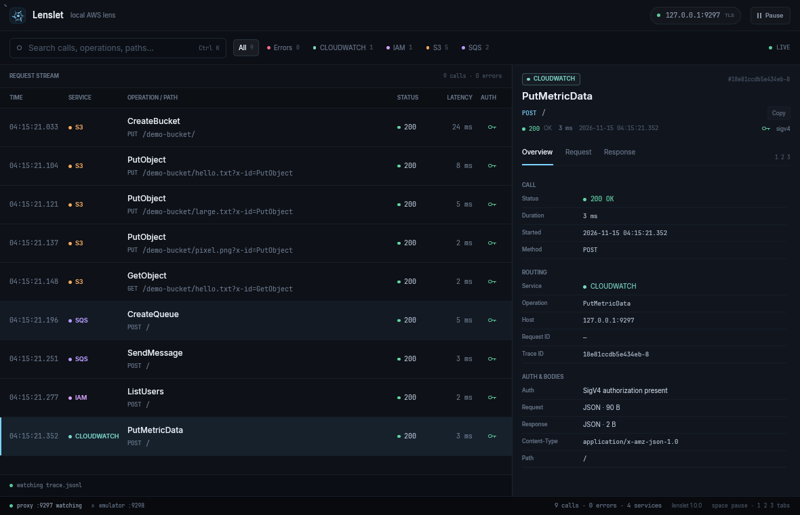

# Lenslet

**A small lens on your local AWS.** Lenslet sits between an AWS SDK and
[AWS Emulator](https://github.com/aws/aws-emulator), records the wire calls, and
shows them in one native GPUI window.



Lenslet is the current product in this repository. It is deliberately small:
a TLS proxy, a live stream, and an inspector. There is no cloud console, replay,
resource graph, Pi session, celld, or agent runtime in it.

## Start here

- [Lenslet 1.0 README](lenslet/README.md) — install, SDK setup, architecture,
  service coverage, limits.
- [Release notes](lenslet/RELEASE_NOTES.md) — what changed in 1.0.0.
- [Trace contract](lenslet/docs/trace.md) — raw request/response JSONL format.
- [Lenslet 1.0.0 release](https://github.com/hxddh/celagent/releases/tag/lenslet-v1.0.0)
  — Linux x86_64 binaries.

```bash
# one terminal: emulator
EMULATOR_TELEMETRY=off aws-emulator --telemetry off --port 9298

# another: proxy
cd lenslet
cargo run --release -p lenslet-proxy

# a third: native window
cd lenslet
cargo run --release -p lenslet
```

Point an SDK at `https://127.0.0.1:9297` and trust
`~/.lenslet/proxy-cert.pem`. Any AWS service the emulator routes through the
proxy appears in the stream; service names come from the SigV4 scope. See the
[Lenslet README](lenslet/README.md) for the tested set and operation naming.

## Legacy celagent 4.x

The previous agent-computer product remains archived for reference:
[docs/celagent-4.1.md](docs/celagent-4.1.md). It is not the current product.
