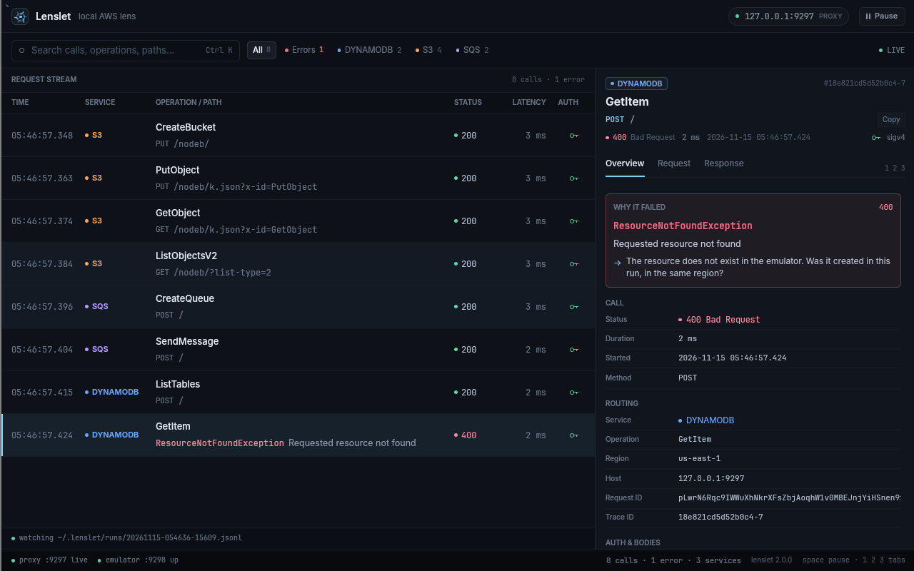

# Lenslet

**See, in every pull request, what AWS access your code needs, and why its
AWS calls failed.**

Lenslet runs your tests against a local AWS emulator. It records every AWS
call, explains failures, and works out the IAM permissions the code uses. It
keeps those permissions in `lenslet.lock`, a file you commit. When a pull
request widens AWS access, the PR says so, call by call, and CI fails until
someone accepts the change.

AWS Emulator does not evaluate IAM, so code that works locally can still be
denied on AWS. Lenslet covers that gap in code review—and, with `--enforce`,
blocks unauthorized calls live at the proxy with real AWS `AccessDenied`
responses before they ever reach the emulator.

> **Lenslet · `npm test` passed**
>
> 15 AWS calls · 0 errors · 4 services
>
> **1 permission not in `lenslet.lock`.** Review it; if it is intended, run `lenslet run --update` and commit `lenslet.lock`.
>
> | | Permission | Resource | Needed by |
> |---|---|---|---|
> | + | `dynamodb:DeleteItem` | `arn:aws:dynamodb:*:*:table/orders` | DYNAMODB DeleteItem |

## Start

```bash
curl -fsSL https://github.com/hxddh/lenslet/releases/latest/download/install.sh | sh

# with your emulator running (e.g. AWS Emulator on 9298):
lenslet init -- npm test
```

`lenslet init` checks that the emulator answers, runs your tests once to
write `lenslet.lock`, and adds `.github/workflows/lenslet.yml`. Review the
lock, mark lines that only your test fixtures need with `# test`, then commit
both files. From then on every pull request gets the report.

On a Mac, [Lenslet.dmg](https://github.com/hxddh/lenslet/releases/latest) also
gives you the window. The app is not notarized yet, so the first time you open
it go to System Settings → Privacy & Security → Open Anyway.

## In CI

The workflow `lenslet init` writes uses the Lenslet action:

```yaml
permissions:
  contents: read
  pull-requests: write          # one PR comment, updated in place
steps:
  - uses: actions/checkout@v5
  # install your test dependencies
  - uses: hxddh/lenslet@lenslet-v5.0.0
    with:
      command: npm test
      emulator: moto_server -p 9298           # or however you start your emulator
      upstream: http://127.0.0.1:9298
```

The action does five things:

- It installs the pinned Lenslet and checks its checksum.
- It starts the emulator if you give it one, and waits until it answers.
- It runs your command with `--check`.
- It writes the report to the job summary.
- It keeps one PR comment up to date.

Until a `lenslet.lock` exists, it only reports.

| input | default | |
| --- | --- | --- |
| `command` | — | the test command (bash, in `working-directory`) |
| `upstream` | `9298` | the emulator: a port (HTTPS on 127.0.0.1) or a URL |
| `emulator` | | a command that starts the emulator in the background |
| `working-directory` | `.` | where to run and find the lock |
| `lock` | `lenslet.lock` | lock path, relative to `working-directory` |
| `policy` | | IAM policy JSON path to check/enforce instead of `lenslet.lock` |
| `check` | `true` | fail when access grows (exit 3) |
| `strict` | `false` | also fail when the lock lists access the run did not use |
| `enforce` | `false` | actively deny calls outside the lock/policy with AWS `AccessDenied` |
| `comment` | `true` | post or update the PR comment (fork PRs get the job summary only) |
| `version` / `binary` | from the pinned tag | another release, or a binary you built |

Outputs: `exit-code`, and `report`, the path to the JSON report.

For AWS Emulator in CI, install it the way its docs describe (on Linux, a
`.deb` or `.rpm`), then set `emulator: aws-emulator --telemetry off --port 9298`.
[moto](https://github.com/getmoto/moto) (`pip install 'moto[server]'`) and
LocalStack also work as upstreams. Lenslet's own CI runs the action this way
against [examples/python](examples/python).

## What a run shows

```console
$ lenslet run --check -- npm test
...your tests...
lenslet: 15 calls · 2 errors · 4 services (dynamodb, lambda, s3, sqs) · 476 ms
  ✗ S3 GetObject  404  NoSuchKey  The specified key does not exist.
      → The resource does not exist in the emulator. Was it created in this run, in the same region?
  access: 1 permission not in lenslet.lock
    + dynamodb:DeleteItem              arn:aws:dynamodb:*:*:table/orders
  unused: 1 permission in lenslet.lock not exercised by this run
    - dynamodb:GetItem                 arn:aws:dynamodb:*:*:table/orders
```

- **Why it failed**: the AWS error code and message, plus a one-line likely
  cause for common local failures.
- **What it needs**: each call becomes an IAM action on a resource ARN, with
  account and region as `*`. The mapping covers:
  - batches: one entry per table;
  - transactions: each item's own action;
  - copies: the source as well as the destination;
  - implied permissions: `kms:Decrypt` behind SSE-KMS, `iam:PassRole` for
    roles passed to Lambda.

  Generated names (UUIDs, timestamps) become `*`, so the lock stays stable.
- **What changed**: compared with `lenslet.lock` (added, unused) and with the
  previous run of the same command (new failures, fixed).

This is **observed** access: what your tests exercised, mapped by rules. It
is not a security review. Code paths the tests never reach are not in the lock.

### The lock

```text
# lenslet.lock
dynamodb:CreateTable  arn:aws:dynamodb:*:*:table/orders  # test
dynamodb:PutItem      arn:aws:dynamodb:*:*:table/orders
kms:Decrypt           arn:aws:kms:*:*:key/*  # implied
s3:GetObject          arn:aws:s3:::shop-receipts/*
```

The lock has one permission per line, sorted. `# test` marks access that only
the tests need (fixtures creating tables or buckets). `--check` still counts
those lines, but `lenslet policy` leaves them out. `lenslet run --update`
rewrites the lock and keeps the marks. It only writes when the command passed.

## The window

`lenslet ui` (or `Lenslet.app`) shows the newest run live. It has two views:

- **Calls**: every call, with errors and `BLOCKED` markers in the row, `Copy curl` (`c`), formatted/raw wire toggle, and binary Hex + ASCII preview in the inspector.
- **Access** (`a`): one row per permission. Click a row to see the calls
  behind it.

`[` and `]` step through earlier runs. `t` switches between System, Light and
Dark themes; `l` toggles Chinese / English UI labels (keeping AWS, IAM and HTTP
technical terms canonical). Preferences are stored in `~/.lenslet/ui.json`.



## For agents

Every run ends with one JSON report, the same object in three places:

- the last line of the run file;
- `lenslet run --json PATH` (`-` for stdout);
- `lenslet last --json`, which reads the newest run without re-running it.

`--markdown PATH` writes the PR-comment version.

| exit code | meaning |
| --- | --- |
| the command's | the command failed |
| `3` | the command passed, but `--check` found access not in the lock (or, with `--strict`, unused) |
| `2` | Lenslet could not run |
| `0` | otherwise |

The format is in [docs/trace.md](docs/trace.md).

## Commands

```text
lenslet init [--upstream ADDRESS] -- COMMAND   first run: lock + CI workflow
lenslet run [options] [--] COMMAND             run under Lenslet; report at the end
lenslet run [options]                          no command: a proxy on 127.0.0.1:9297
lenslet last [--json]                          the newest run's report
lenslet policy [--lock PATH]                   an IAM policy from the lock (without `# test` lines)
lenslet ui                                     the window

run: --enforce  --check  --strict  --update  --lock PATH  --policy PATH
     --max-body SIZE  --json PATH  --markdown PATH  --quiet  --ui  --no-env
     --listen PORT  --upstream ADDRESS  --emulator-ca PATH  --trace PATH
```

`lenslet run` sets the following for the child process:

- `AWS_ENDPOINT_URL`;
- the emulator's credentials and config, when you have not set your own;
- placeholder keys, when the emulator has no credentials file.

It always removes ambient cloud credentials (`AWS_ACCESS_KEY_ID`,
`AWS_SECRET_ACCESS_KEY`, `AWS_SESSION_TOKEN`, `AWS_PROFILE`,
`AWS_WEB_IDENTITY_TOKEN_FILE`, `AWS_ROLE_ARN`, `AWS_CONTAINER_CREDENTIALS_*`,
`AWS_BEARER_TOKEN_BEDROCK`) from the environment it hands over, so real
credentials never reach the emulator or the unredacted local trace. `--no-env`
sets only the endpoint. Both `127.0.0.1` and `localhost` work on IPv4 and IPv6
loopback.

## Install

| | |
| --- | --- |
| any Linux, macOS (CLI) | `curl -fsSL https://github.com/hxddh/lenslet/releases/latest/download/install.sh \| sh` |
| macOS (app + CLI) | `Lenslet-X.Y.Z.dmg`: universal (Apple silicon and Intel). The CLI is inside the app at `Lenslet.app/Contents/MacOS/lenslet`. |
| Linux (CLI + window) | `lenslet-X.Y.Z-{x86_64,aarch64}-linux.tar.gz` (glibc ≥ 2.35) |
| CI images, Alpine | `lenslet-cli-X.Y.Z-{x86_64,aarch64}-linux-musl.tar.gz`: static |

Every asset is listed in the release's `SHA256SUMS`, and `install.sh` checks
the file it downloads against it. To uninstall, delete the binary (or the app)
and `~/.lenslet`. That directory holds raw local traces, including request
headers.

## Files

| path | what |
| --- | --- |
| `lenslet.lock` | the access your project needs; commit it |
| `.github/workflows/lenslet.yml` | written by `lenslet init` |
| `~/.lenslet/runs/*.jsonl` | one file per run (header, calls, report); the last 20 finished runs are kept |

Run files are a local development artifact. They hold raw headers and text
bodies, and are written owner-only (`0600`). Do not commit them.

## Build from source

You need Rust 1.88+. The window also needs the GPUI Linux libraries
(`libxkbcommon-dev`, `libxkbcommon-x11-dev`, `libwayland-dev`,
`libx11-xcb-dev`, `libxcb1-dev`, `libvulkan-dev`, `libfontconfig1-dev`,
`libfreetype-dev`, `pkg-config`, `cmake`, `clang`) and a Vulkan driver.

```bash
cargo build --release -p lenslet          # CLI: no graphics libraries
cargo build --release -p lenslet-ui       # the window
cargo test --workspace
```

```text
crates/cli     lenslet: proxy, error and access derivation, lock, reports, init
crates/ui      lenslet-ui: the GPUI window (reads run files; no IAM logic)
action.yml     the GitHub Action
install.sh     the installer
examples/      a project the action is tested against
```

## Limits

- Between the SDK and the proxy: HTTP/1.1 only, loopback only.
- Capture keeps the first 1 MiB of each body by default (`--max-body` or
  `--max-body unlimited` to change), unframing `aws-chunked` streams and
  decompressing `gzip` and `deflate` for inspection while forwarding wire bytes
  untouched and unredacted.
- Resources are read for S3, DynamoDB, SQS, SNS, Lambda, SSM Parameter Store,
  CloudWatch Logs, Kinesis, Bedrock, Secrets Manager, KMS, STS, IAM, EventBridge
  and Step Functions. Other services get `*`. Calls with unrecognized operations
  are reported as unmapped rather than guessed.
- No Windows build. The macOS app is not notarized.

Earlier versions: [lenslet-v4.1.0](https://github.com/hxddh/lenslet/tree/lenslet-v4.1.0).
This repository used to be `celagent`; that project is at
[v4.1.0](https://github.com/hxddh/lenslet/tree/v4.1.0).

## License

Apache-2.0. The bundled fonts are under the SIL Open Font License; see
`assets/fonts/`.
