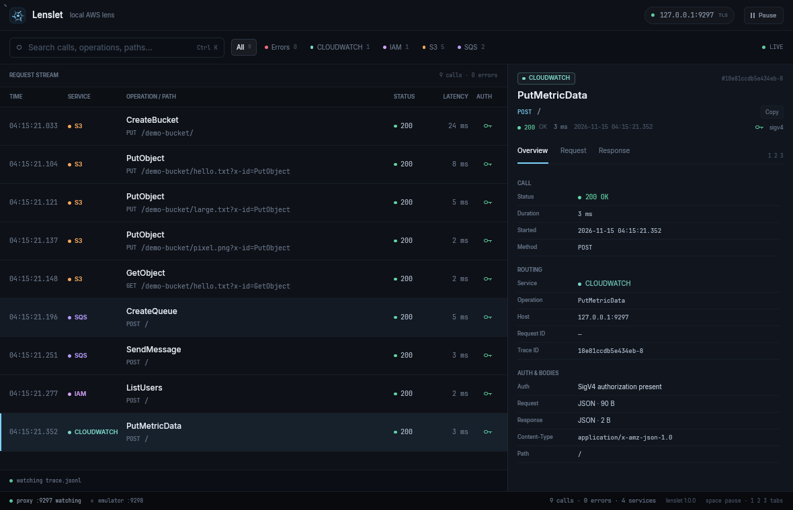

# Lenslet 1.0

**A small lens on your local AWS.** Lenslet sits between an AWS SDK and
[AWS Emulator](https://github.com/aws/aws-emulator), records the wire calls, and
shows them in one native GPUI window. It is the current product in this
repository; the old celagent 4.x runtime is archived at
[`docs/celagent-4.1.md`](https://github.com/hxddh/celagent/blob/main/docs/celagent-4.1.md).



## Why it exists

AWS Emulator gives you a local AWS API but no view of what your SDK actually
sent. Lenslet is a transparent TLS proxy plus a dense, quiet inspector:

- **Live wire stream** — every call appears as it completes.
- **Original request and response** — headers and text bodies, not a normalized
  resource model.
- **Any emulator service** — the service is read from the SigV4 credential
  scope; there is no per-service allowlist.
- **Fast questions** — search across service, operation, method, path, status
  and body; filter by errors or by a service; inspect a call without leaving the
  stream.
- **Small** — one window, no console, no replay, no resource graph, no agent
  runtime.

Lenslet records behavior. It does not claim that every emulator response matches
real AWS; fidelity is an AWS Emulator concern. Where a protocol advertises an
operation, Lenslet shows it: `x-amz-target`, S3 `x-id`, and AWS Query
`Action=...` are recognized. Other REST calls fall back to the HTTP method.

## Install

The first release ships a Linux x86_64 archive and a macOS app archive. The
macOS asset name includes the runner architecture (`macos-arm64` or
`macos-x86_64`); the app is ad-hoc signed but not notarized.

```bash
curl -fL -o lenslet.tar.gz \
  https://github.com/hxddh/celagent/releases/download/lenslet-v1.0.0/lenslet-1.0.0-linux-x86_64.tar.gz
tar xzf lenslet.tar.gz
cd lenslet-1.0.0-linux-x86_64

# in one terminal
EMULATOR_TELEMETRY=off aws-emulator --telemetry off --port 9298

# in another
./lenslet-proxy --listen 9297 --upstream 9298

# in a third
./lenslet
```

For macOS, unpack the corresponding archive, then:

```bash
xattr -dr com.apple.quarantine Lenslet.app   # only if Gatekeeper complains
open Lenslet.app
# separate terminal, from the same directory:
./lenslet-proxy --listen 9297 --upstream 9298
```

The emulator writes its credentials and CA under
`~/.aws/emulator/9298/`. The proxy reads `ca.pem` there by default, generates
`~/.lenslet/proxy-cert.pem` / `proxy-key.pem`, and appends the trace to
`~/.lenslet/trace.jsonl`.

Point the SDK at `https://127.0.0.1:9297` and trust the proxy certificate. For a
Node SDK:

```bash
export AWS_SHARED_CREDENTIALS_FILE="$HOME/.aws/emulator/9298/emulator_credentials"
export AWS_CONFIG_FILE="$HOME/.aws/emulator/9298/config"
export NODE_EXTRA_CA_CERTS="$HOME/.lenslet/proxy-cert.pem"
# endpoint: https://127.0.0.1:9297
```

For the AWS CLI:

```bash
export AWS_ENDPOINT_URL=https://127.0.0.1:9297
export AWS_CA_BUNDLE="$HOME/.lenslet/proxy-cert.pem"
export AWS_SHARED_CREDENTIALS_FILE="$HOME/.aws/emulator/9298/emulator_credentials"
export AWS_CONFIG_FILE="$HOME/.aws/emulator/9298/config"
```

## Build from source

Prerequisites: Rust 1.100+, a C toolchain, and the GPUI Linux libraries
(`libxkbcommon-dev`, `libxkbcommon-x11-dev`, `libwayland-dev`, `libx11-xcb-dev`,
`libxcb1-dev`, `libvulkan-dev`, `libfontconfig1-dev`, `libfreetype-dev`,
`libssl-dev`, `pkg-config`, `cmake`, `clang`). A running Vulkan driver is needed
to render the window.

```bash
cd lenslet
cargo build --release -p lenslet -p lenslet-proxy
cargo test --workspace
./target/release/lenslet-proxy --help
```

For a headless development machine, use Xvfb plus a compositor and software
Vulkan (`VK_ICD_FILENAMES=/usr/share/vulkan/icd.d/lvp_icd.json`). The screenshot
above was captured that way.

## Trace

One call is one JSON object per line. The top-level fields are stable:

```json
{
  "id": "18e818145ad34e13-0",
  "at": "2026-11-15T02:48:47.209355287+00:00",
  "method": "PUT",
  "path": "/bucket/key?x-id=PutObject",
  "host": "127.0.0.1:9297",
  "service": "s3",
  "operation": "PutObject",
  "status": 200,
  "ms": 2,
  "authorization": true,
  "request": {
    "headers": [{"name": "authorization", "value": "AWS4-HMAC-SHA256 ..."}],
    "content_type": "application/json",
    "body": {"text": "…", "bytes": 39, "truncated": false, "binary": false, "sha256": "…"}
  },
  "response": {
    "headers": [],
    "content_type": "application/xml",
    "body": {"text": "…", "bytes": 141, "truncated": false, "binary": false, "sha256": "…"}
  }
}
```

Reference: [`lenslet/docs/trace.md`](docs/trace.md) for the exact contract and
capture limits.

The trace is a **local development artifact**. It contains raw headers and text
bodies, including Authorization, by design. It is created owner-only (`0600`).
Do not commit it or attach it to a public issue.

## Service coverage

Lenslet is wire-level, so service coverage is not a hardcoded list: any AWS
service that AWS Emulator routes through the proxy appears in the stream. The
emulator repository currently contains 400+ service crates, including S3, SQS,
SNS, DynamoDB, Lambda, IAM, STS, KMS, CloudFormation, EventBridge, CloudWatch
Logs, API Gateway, ECR/ECS/EC2, RDS, Step Functions, Secrets Manager, SSM,
Kinesis, Firehose, SES, Route 53, ELB, Scheduler, Athena and Glue.

That is wire coverage, not a fidelity guarantee. The 1.0 verification set is S3
(CreateBucket / PutObject / GetObject), SQS (CreateQueue / SendMessage), IAM
(ListUsers) and CloudWatch (PutMetricData), all through the real TLS proxy with
the AWS SDK. Unknown services are displayed with a stable color and are included
in the dynamic filter strip.

## Limits

- Linux x86_64 and macOS are the shipped targets. The macOS app is ad-hoc
  signed, not notarized; Gatekeeper may require the one-time `xattr` step.
  Windows is not shipped in 1.0.
- GPUI 0.2.2 pulls `xattr 0.2.3`, which does not build on Linux because
  `libc::ENOATTR` is unavailable. `vendor/xattr` substitutes `ENODATA`; remove
  the patch when GPUI fixes it.
- Text capture is the first 64 KiB per request/response. Binary bodies store
  only byte count and SHA-256. Forwarding is streamed and byte-exact.
- Operation naming is protocol-derived; a REST operation that advertises no
  operation identifier is shown as its HTTP method.
- AWS Emulator fidelity varies by service; Lenslet reports the wire, not AWS
  equivalence.

## Development

```text
crates/proxy   TLS proxy: 127.0.0.1:9297 -> emulator 127.0.0.1:9298
crates/app     GPUI single-window UI
assets/fonts   Inter + JetBrains Mono, SIL OFL
vendor/xattr   Linux build workaround for gpui 0.2.2
```

```bash
cd lenslet
cargo test --workspace
cargo build -p lenslet -p lenslet-proxy
cargo fmt --all -- --check
```

## License

Lenslet is Apache-2.0. The bundled fonts are under the SIL Open Font License;
their license files are in `assets/fonts/`.
